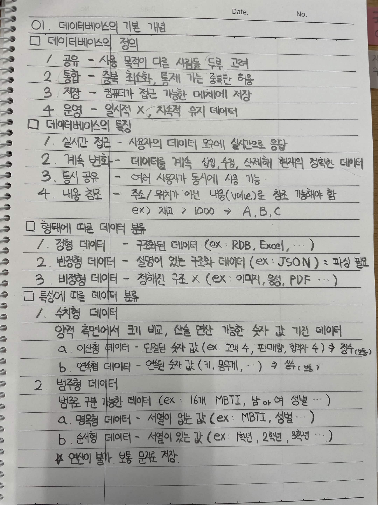

# 1. 데이터베이스의 기본 개념

## 데이터베이스의 정의

1. 공유: 사용 목적이 다른 사람들을 두루 고려
2. 통합: 중복을 최소화하고 통제 가능한 중복만 허용
3. 저장: 컴퓨터가 접근 가능한 매체에 저장
4. 운영: 일시적인 데이터가 아닌 지속적으로 유지되는 데이터

## 데이터베이스의 특징

1. 실시간 접근: 사용자의 데이터 요구에 실시간으로 응답
2. 계속 변화: 데이터를 계속 삽입, 수정, 삭제하여 현재의 정확한 데이터를 유지
3. 동시 공유: 여러 사용자가 동시에 사용 가능
4. 내용 참조: 주소나 위치가 아닌 내용으로 데이터를 참조할 수 있어야 함

&#x20;  예시: 재고가 1000개 이상인 상품을 조회하면 해당 조건에 맞는 데이터를 검색

## 형태에 따른 데이터 분류

1\. 정형 데이터

- 구조화된 데이터
- 예시: RDB, Excel

2\. 반정형 데이터

- 설명이나 구조를 나타내는 정보가 있는 데이터
- 예시: JSON
- 데이터를 사용하기 위해 파싱이 필요함

3\. 비정형 데이터

- 정해진 구조가 없는 데이터
- 예시: 이미지, 음성, PDF

## 특성에 따른 데이터 분류

### 1. 수치형 데이터

양적 측면에서 크기 비교와 산술 연산이 가능한 숫자 값을 가진 데이터

#### 가. 이산형 데이터

- 단절된 숫자 값
- 예시: 고객 수, 판매량, 합격자 수
- 정수 형태로 표현

#### 나. 연속형 데이터

- 연속된 숫자 값
- 예시: 키, 몸무게
- 실수 형태로 표현

### 2. 범주형 데이터

범주로 구분할 수 있는 데이터

#### 가. 명목형 데이터

- 서열이 없는 값
- 예시: MBTI, 성별

#### 나. 순서형 데이터

- 서열이 있는 값
- 예시: 1학년, 2학년, 3학년

\- 연산이 불가능하며 보통 문자로 저장함

