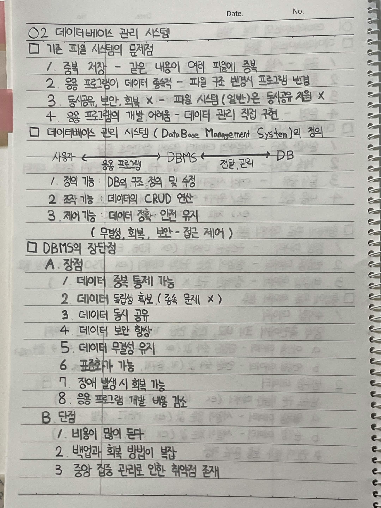
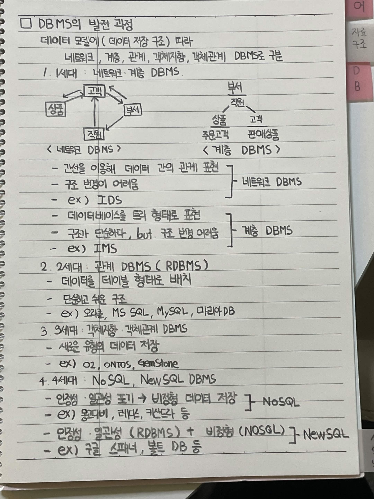

# 데이터베이스 관리 시스템

## 1. 기존 파일 시스템의 문제점

1. 중복 저장: 같은 내용이 여러 파일에 중복 저장됨
2. 응용 프로그램의 데이터 종속성: 파일 구조가 변경되면 프로그램도 변경해야 함
3. 데이터 공유와 보안 및 회복의 어려움: 파일 시스템은 동시 공유를 지원하기 어려움
4. 응용 프로그램 개발의 어려움: 데이터 관리를 직접 구현해야 함

## 2. 데이터베이스 관리 시스템의 정의

DBMS는 데이터베이스를 생성하고 관리하는 소프트웨어이다.

사용자와 응용 프로그램은 DBMS를 통해 데이터베이스에 접근한다.

### DBMS의 주요 기능

1. 정의 기능: 데이터베이스의 구조를 정의하고 수정
2. 조작 기능: 데이터의 CRUD 연산 수행
3. 제어 기능: 데이터의 정확성과 안전성 유지

제어 기능에는 무결성 유지, 회복, 보안, 접근 제어 등이 포함된다.

## 3. DBMS의 장단점

### 장점

1. 데이터 중복 통제 가능
2. 데이터 독립성 확보
3. 데이터 동시 공유 가능
4. 데이터 보안 향상
5. 데이터 무결성 유지
6. 데이터 표준화 가능
7. 장애 발생 시 회복 가능
8. 응용 프로그램 개발 비용 감소

### 단점

1. 구축 및 운영 비용이 많이 듦
2. 백업과 회복 방법이 복잡함
3. 중앙 집중 관리로 인한 취약점이 존재함

## 4. DBMS의 발전 과정

### 1세대 네트워크 및 계층 DBMS

네트워크 DBMS

- 간선을 이용해 데이터 간 관계를 표현
- 구조 변경이 어려움
- 예시: IDS

계층 DBMS

- 데이터를 트리 형태로 표현
- 구조가 단순하지만 구조 변경이 어려움
- 예시: IMS

### 2세대 관계형 DBMS

- 데이터를 테이블 형태로 저장
- 단순하고 이해하기 쉬운 구조
- 예시: Oracle, MS SQL Server, MySQL, MariaDB

### 3세대 객체지향 및 객체관계 DBMS

- 객체 형태의 데이터 저장 지원
- 새로운 유형의 데이터 저장 가능
- 예시: O2, ONTOS, GemStone

### 4세대 NoSQL 및 NewSQL DBMS

NoSQL

- 일관성보다 확장성과 가용성을 중시하는 경우가 많음
- 비정형 및 다양한 형태의 데이터 저장
- 예시: MongoDB, Redis, Cassandra

NewSQL

- 관계형 DBMS의 일관성과 NoSQL의 확장성을 결합
- 관계형 데이터 처리와 분산 처리를 지원
- 예시: Google Spanner, VoltDB

