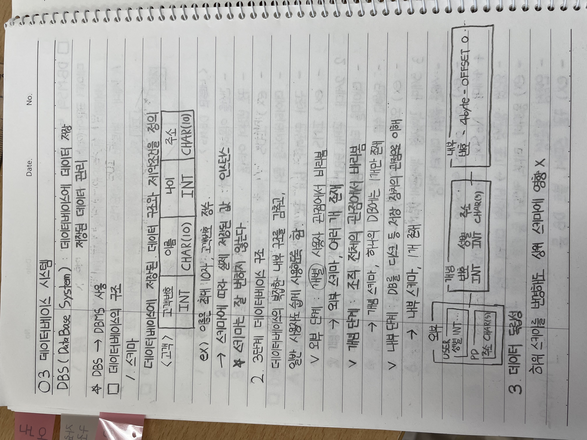
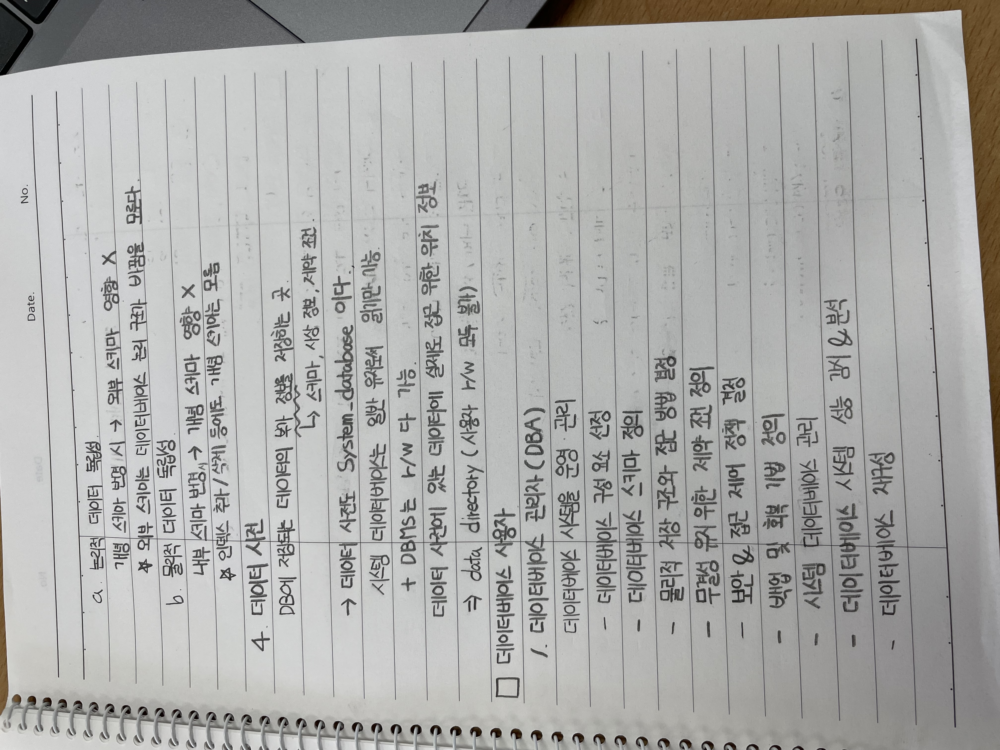
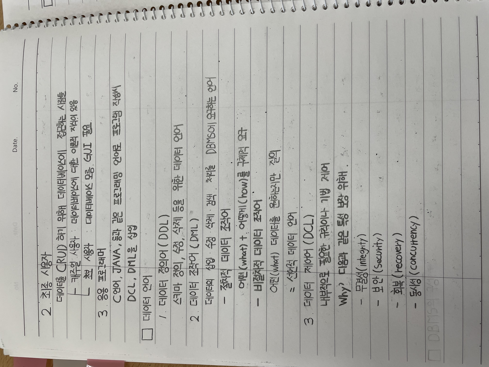
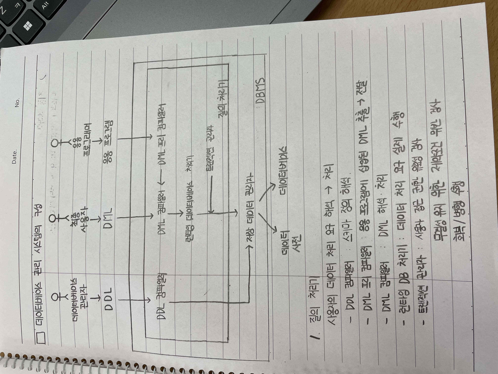
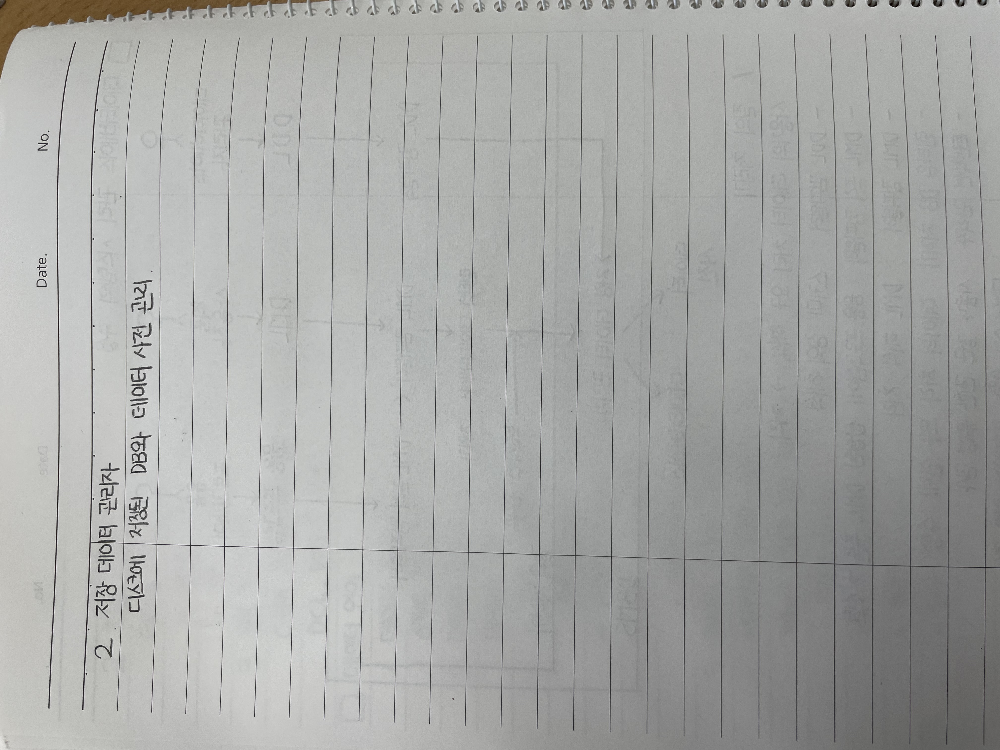

# 03 데이터베이스 시스템

## 1. DBS (DataBase System)

데이터베이스에 데이터를 저장하고, 저장된 데이터를 관리하는 시스템

- DBS에서는 DBMS를 사용한다.

## 2. 데이터베이스의 구조

### 1. 스키마 (Schema)

데이터베이스에 저장될 데이터의 구조와 제약 조건을 정의한다.

예시) 고객 테이블

| 고객 | 고객번호 | 이름 | 나이 | 주소 |
|---|---|---|---|---|
| 자료형 | INT | CHAR(10) | INT | CHAR(10) |

예시
- 이름은 최대 10자
- 고객번호는 정수

스키마에 따라 실제로 저장된 값을 인스턴스(Instance)라고 한다.

- 스키마는 자주 변하지 않는다.

### 2. 3단계 데이터베이스 구조

데이터베이스의 복잡한 내부 구조를 감추고, 일반 사용자도 쉽게 사용할 수 있도록 하는 구조이다.

#### 외부 단계 (External Level)

- 개별 사용자 관점에서 바라본 데이터베이스
- 외부 스키마(External Schema)
- 여러 개 존재할 수 있다.
- 사용자마다 필요한 데이터의 일부만 볼 수 있다.

#### 개념 단계 (Conceptual Level)

- 조직 전체의 관점에서 바라본 데이터베이스
- 개념 스키마(Conceptual Schema)
- 하나의 DB에는 1개만 존재한다.
- 데이터베이스 전체의 논리적인 구조를 정의한다.

#### 내부 단계 (Internal Level)

- DB를 디스크 등 저장 장치의 관점에서 이해한다.
- 내부 스키마(Internal Schema)
- 1개 존재한다.
- 실제 데이터의 저장 방식과 물리적인 구조를 정의한다.

### 3. 데이터 독립성 (Data Independence)

하위 스키마를 변경해도 상위 스키마에 영향을 주지 않는 특성이다.

#### a. 논리적 데이터 독립성

- 개념 스키마 변경 시 외부 스키마에 영향이 없다.
- 외부 스키마는 데이터베이스의 논리적인 구조를 몰라도 된다.

#### b. 물리적 데이터 독립성

- 내부 스키마 변경 시 개념 스키마에 영향이 없다.
- 인덱스 추가 및 삭제 등의 변경에도 개념 스키마는 변하지 않는다.

## 3. 데이터 사전 (Data Dictionary)

DB에 저장되는 데이터의 부가 정보를 저장하는 곳이다.

저장되는 정보
- 스키마
- 사용자 정보
- 제약 조건

데이터 사전도 System Database이다.

- 시스템 데이터베이스는 일반 사용자에게 읽기만 가능하다.
- DBMS는 읽기와 쓰기 모두 가능하다.

데이터 사전에 있는 데이터에 실제로 접근하기 위한 위치 정보는 데이터 디렉터리(Data Directory)에서 관리한다.

- 데이터 디렉터리는 사용자에게 읽기와 쓰기 모두 불가능하다.

## 4. 데이터베이스 사용자

### 1. 데이터베이스 관리자 (DBA)

데이터베이스 시스템을 운영하고 관리한다.

주요 역할

- 데이터베이스 구성 요소 선정
- 데이터베이스 스키마 정의
- 물리적 저장 구조와 접근 방법 변경
- 무결성 유지를 위한 제약 조건 정의
- 보안 및 접근 제어 정책 결정
- 백업 및 회복 기법 정의
- 시스템 데이터베이스 관리
- 데이터베이스 시스템 성능 감시 및 분석
- 데이터베이스 재구성

### 2. 최종 사용자 (End User)

데이터를 CRUD(Create, Read, Update, Delete)하기 위해 데이터베이스에 접근하는 사람이다.

- 캐주얼 사용자
  - 데이터베이스에 대한 이론적 지식이 있음
  - 직접 질의를 작성하여 데이터에 접근할 수 있음

- 초보 사용자
  - 데이터베이스에 대한 지식이 부족함
  - 데이터베이스 사용을 위한 GUI가 필요함

### 3. 응용 프로그래머 (Application Programmer)

C언어, JAVA 등과 같은 프로그래밍 언어로 프로그램 작성 시 DCL, DML 등을 삽입한다.

## 5. 데이터 언어

### 1. 데이터 정의어 (DDL, Data Definition Language)

스키마 정의, 수정, 삭제 등을 위한 데이터 언어이다.

- CREATE : 생성
- ALTER : 수정
- DROP : 삭제

### 2. 데이터 조작어 (DML, Data Manipulation Language)

데이터의 삽입, 수정, 삭제, 검색 처리를 DBMS에 요청하는 언어이다.

#### 절차적 데이터 조작어

- 어떤 데이터(What)와 어떻게(How)를 구체적으로 요구한다.
- 데이터에 접근하는 방법까지 명시한다.

#### 비절차적 데이터 조작어

- 어떤(What) 데이터를 원하는지만 질의한다.
- 데이터를 가져오는 방법은 DBMS가 결정한다.
- 선언적 데이터 언어라고도 한다.

### 3. 데이터 제어어 (DCL, Data Control Language)

내부적으로 필요한 규칙이나 기법을 제어하는 언어이다.

다음과 같은 특성을 보장하기 위해 사용한다.

- 무결성 (Integrity)
- 보안 (Security)
- 회복 (Recovery)
- 동시성 (Concurrency)

## 6. 데이터베이스 관리 시스템의 구성

데이터베이스 관리 시스템(DBMS)은 사용자와 데이터베이스 사이에서 데이터의 정의, 조작, 제어 및 관리를 수행한다.

### 사용자별 역할과 데이터 언어

| 사용자 | 사용하는 언어 및 도구 |
|---|---|
| 데이터베이스 관리자(DBA) | DDL |
| 최종 사용자 | DML |
| 응용 프로그래머 | 응용 프로그램에 DML 삽입 |

### DBMS의 구성 요소

#### 1. 질의 처리기 (Query Processor)

사용자의 데이터 처리 요구를 해석하고 처리한다.

- **DDL 컴파일러**
  - 스키마 정의를 해석한다.
  - 데이터베이스의 구조를 정의하거나 변경한다.

- **DML 프리 컴파일러**
  - 응용 프로그램에 삽입된 DML을 추출한다.
  - 추출한 DML을 DML 컴파일러에 전달한다.

- **DML 컴파일러**
  - DML을 해석하고 처리한다.
  - 사용자의 데이터 조작 요청을 처리할 수 있는 형태로 변환한다.

- **런타임 데이터베이스 처리기**
  - 데이터 처리 요구를 실제로 수행한다.
  - 데이터베이스에 접근하여 데이터를 처리한다.

- **트랜잭션 관리자**
  - 사용자 접근 권한의 유효성을 검사한다.
  - 무결성 유지를 위한 제약 조건 위반을 검사한다.
  - 회복 및 병행 수행을 관리한다.

#### 2. 저장 데이터 관리자 (Stored Data Manager)

디스크에 저장된 데이터베이스와 데이터 사전을 관리한다.

- 데이터베이스에 실제로 저장된 데이터 관리
- 데이터 사전 관리
- 데이터에 접근하고 저장하는 작업 지원

---

