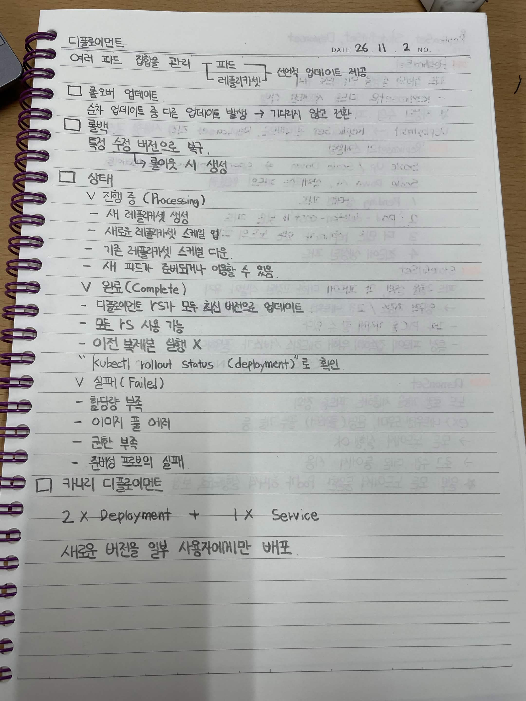

# 디플로이먼트(Deployment)

## 1. 디플로이먼트란?

- 여러 파드 집합을 관리하는 리소스
- 파드와 레플리카셋을 관리
- 선언적인 업데이트 제공

## 2. 롤링 업데이트(Rolling Update)

- 기존 파드를 한 번에 종료하지 않고 순차적으로 업데이트
- 순차 업데이트 중 다른 업데이트가 발생하면 기다리지 않고 전환

## 3. 롤백(Rollback)

- 특정 수정 버전으로 복구
- 롤아웃 시 새로운 레플리카셋 생성

## 4. 디플로이먼트 상태

### 진행 중 (Processing)

- 새 레플리카셋 생성
- 새로운 레플리카셋 스케일 업
- 기존 레플리카셋 스케일 다운
- 새 파드가 준비되거나 이용 가능해짐

### 완료 (Complete)

- 디플로이먼트의 모든 레플리카셋이 최신 버전으로 업데이트
- 모든 파드 사용 가능
- 이전 버전의 파드 실행 X

확인 명령어:

```
kubectl rollout status deployment
```

### 실패 (Failed)

- 할당량 부족
- 이미지 풀 오류
- 권한 부족
- 준비성 프로브(Readiness Probe) 실패

## 5. 카나리 디플로이먼트(Canary Deployment)

- 새로운 버전을 일부 사용자에게만 배포하는 방식
- 기존 버전과 새로운 버전을 동시에 운영

구성:

```
2 x Deployment + 1 x Service
```

- 기존 버전 Deployment
- 새로운 버전 Deployment
- 하나의 Service로 트래픽 분산
- 새로운 버전을 일부 사용자에게만 배포 가능


