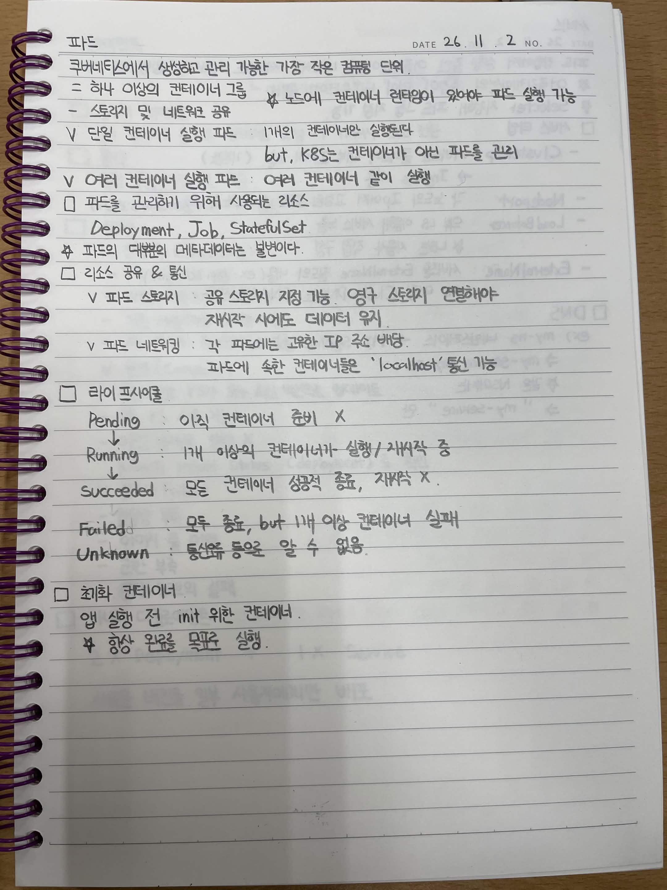

# 파드(Pod)

## 1. 파드란?

- 쿠버네티스에서 생성하고 관리 가능한 가장 작은 컴퓨팅 단위
- 하나 이상의 컨테이너 그룹
- 스토리지 및 네트워크 공유
- 노드에 컨테이너 런타임이 있어야 파드 실행 가능
- 파드의 대부분의 메타데이터는 불변이다.

## 2. 파드 실행 방식

- 단일 컨테이너 실행 파드: 1개의 컨테이너만 실행된다.
- 여러 컨테이너 실행 파드: 여러 컨테이너가 같이 실행된다.

## 3. 파드를 관리하기 위해 사용되는 리소스

- Deployment
- Job
- StatefulSet

## 4. 리소스 공유 및 통신

### 파드 스토리지

- 공유 스토리지 지정 기능
- 영구 스토리지와 연결해야 재시작 시에도 데이터 유지

### 파드 네트워킹

- 각 파드에는 고유한 IP 주소가 배당된다.
- 파드에 속한 컨테이너들은 `localhost` 통신 기능을 사용할 수 있다.

## 5. 라이프사이클

| 상태        | 설명                       |
| --------- | ------------------------ |
| Pending   | 아직 컨테이너 준비 X             |
| Running   | 1개 이상의 컨테이너가 실행 중        |
| Succeeded | 모든 컨테이너 성공적 종료, 재시작 X    |
| Failed    | 모든 종료, but 1개 이상 컨테이너 실패 |
| Unknown   | 통신을 통해 상태를 알 수 없음        |

## 6. 초기화 컨테이너(Init Container)

- 앱 실행 전 초기화를 위한 컨테이너
- 항상 완료를 목표로 실행
- 초기화 컨테이너가 모두 성공적으로 종료된 후 메인 컨테이너가 실행된다.

