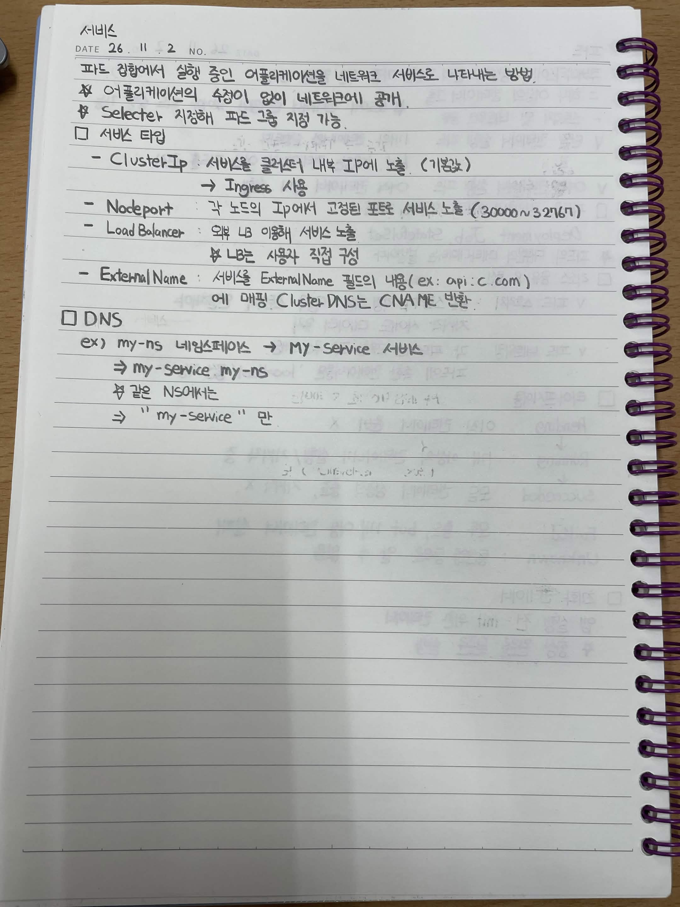

# 서비스(Service)

## 1. 서비스란?

- 파드 집합에서 실행 중인 애플리케이션을 네트워크 서비스로 나타내는 방법
- 애플리케이션의 수정 없이 네트워크에 공개 가능
- Selector를 지정하여 파드 그룹 지정 가능

## 2. 서비스 타입

### ClusterIP

- 서비스를 클러스터 내부 IP에 노출 (기본값)
- 클러스터 내부에서만 접근 가능
- 외부 접근 시 Ingress 사용

### NodePort

- 각 노드의 IP와 고정된 포트를 통해 서비스 노출
- 포트 범위: `30000 ~ 32767`

### LoadBalancer

- 외부 Load Balancer를 이용해 서비스 노출
- Load Balancer는 사용자가 직접 구성해야 함 (환경에 따라 다름)

### ExternalName

- 서비스를 `ExternalName` 필드에 지정된 외부 도메인에 매핑
- 예: `api.c.com`
- 매핑된 도메인은 클러스터 DNS를 통해 CNAME으로 반환

## 3. DNS

예시: 네임스페이스가 `my-ns`이고 서비스 이름이 `my-service`인 경우

```
my-service.my-ns
```

- 같은 네임스페이스에서는 서비스 이름만으로 접근 가능
  - `my-service`
- 다른 네임스페이스에서는 서비스 이름과 네임스페이스를 함께 사용
  - `my-service.my-ns`


