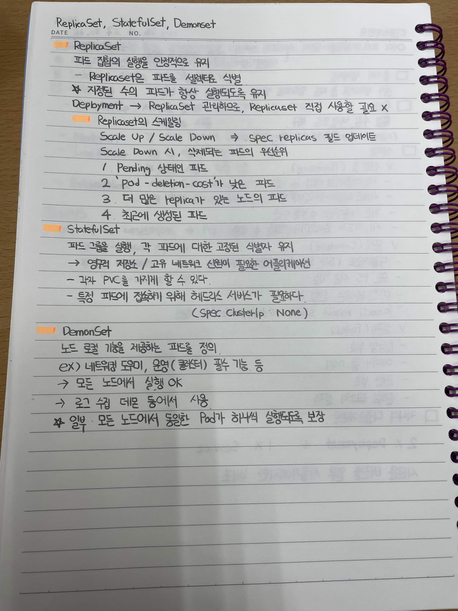

# ReplicaSet, StatefulSet, DaemonSet

## 1. ReplicaSet

- 파드 집합의 실행을 안정적으로 유지
- ReplicaSet은 파드를 Selector로 식별
- 지정된 수의 파드가 항상 실행되도록 유지
- Deployment가 ReplicaSet을 관리하므로 ReplicaSet을 직접 사용할 필요 X

### ReplicaSet의 스케일링

- Scale Up / Scale Down: `spec.replicas` 필드 업데이트
- Scale Down 시 삭제되는 파드의 우선순위

1. Pending 상태인 파드
2. `pod-deletion-cost`가 낮은 파드
3. 더 많은 Replica가 있는 노드의 파드
4. 최근에 생성된 파드

## 2. StatefulSet

- 파드 그룹을 실행하고 각 파드에 대한 고정된 식별자를 유지
- 영구적 저장소와 고유 네트워크 식별이 필요한 애플리케이션에 사용
- 각 파드마다 PVC를 가질 수 있음
- 특정 파드에 접속하기 위해 헤드리스 서비스(Headless Service)가 필요함
- `spec.clusterIP: None`으로 설정

## 3. DaemonSet

- 노드 로컬 기능을 제공하는 파드를 정의
- 예시: 네트워킹 도우미, 로그 수집, 모니터링 에이전트
- 모든 노드에서 실행 가능
- 로그 수집 데몬 등의 용도로 사용

\- 일부 또는 모든 노드에서 동일한 파드가 하나씩 실행되도록 보장

