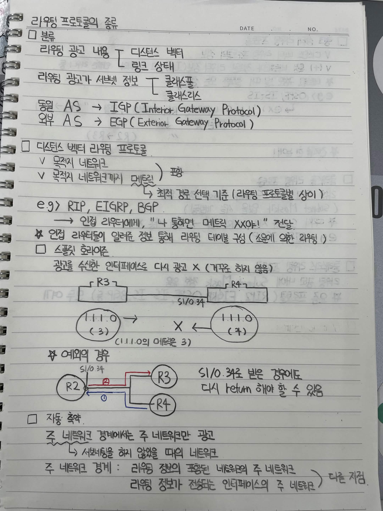
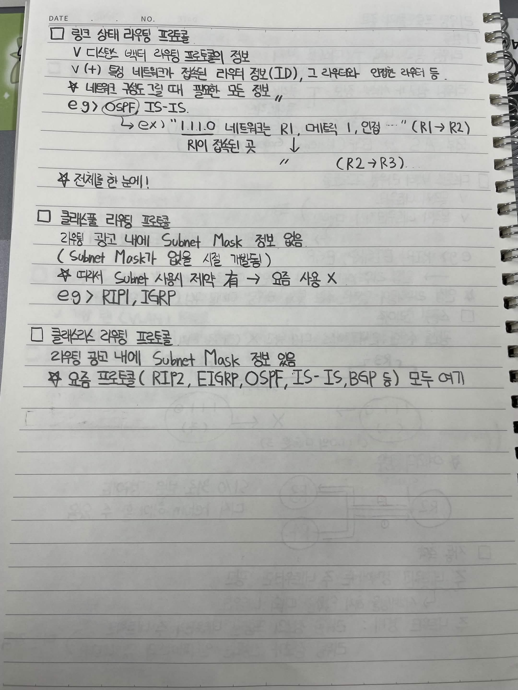

# 라우팅 프로토콜의 종류

## 1. 라우팅 프로토콜의 분류

### 1.1 라우팅 정보의 종류에 따른 분류

- 디스턴스 벡터(Distance Vector)
  - 라우팅 광고 내용: 거리(메트릭), 목적지 네트워크, 링크 상태 등
- 링크 상태(Link State)
  - 라우팅 광고 내용: 링크 상태와 네트워크 토폴로지 정보

### 1.2 라우팅 광고 범위에 따른 분류

- 클래스풀(Classful)
  - 라우팅 광고에 서브넷 마스크 정보가 없음
- 클래스리스(Classless)
  - 라우팅 광고에 서브넷 마스크 정보가 포함됨

### 1.3 AS(Autonomous System)에 따른 분류

- IGP (Interior Gateway Protocol): 동일 AS 내부에서 사용하는 라우팅 프로토콜
- EGP (Exterior Gateway Protocol): 서로 다른 AS 사이에서 사용하는 라우팅 프로토콜

## 2. 디스턴스 벡터 라우팅 프로토콜

### 2.1 특징

- 목적지 네트워크까지의 경로 정보와 메트릭을 포함한다.
- 목적지 네트워크까지의 거리 및 방향을 기준으로 경로를 결정한다.
- 인접 라우터에 라우팅 정보를 전달한다.
- 인접 라우터들이 전달한 정보를 바탕으로 라우팅 테이블을 구성한다. 이를 소문에 의한 라우팅(Routing by Rumor) 이라고 한다.
- 최적 경로 선택 기준은 라우팅 프로토콜마다 다르다.

### 2.2 대표적인 프로토콜

- RIP
- EIGRP
- BGP

### 2.3 스플릿 호라이즌(Split Horizon)

라우팅 정보를 전달받은 인터페이스로는 해당 정보를 다시 광고하지 않는 기법이다.

- 라우팅 루프를 방지하기 위한 기법이다.
- 예를 들어 R3가 R4로부터 `1.1.1.0` 네트워크 정보를 전달받았다면, R3는 해당 정보를 다시 R4 방향으로 광고하지 않는다.

예시:

```
R3 ---------------- R4
      S1/0.34

R3: 1.1.1.0 네트워크의 메트릭 = 3
R4: 1.1.1.0 네트워크의 메트릭 = 7
```

R3가 R4로부터 `1.1.1.0`의 경로 정보를 전달받은 경우, 스플릿 호라이즌에 의해 R3는 해당 정보를 R4로 다시 광고하지 않는다.

### 2.4 스플릿 호라이즌의 예외

스플릿 호라이즌이 적용되더라도 상황에 따라 라우팅 정보를 다시 전달해야 하는 경우가 있다.

- 예를 들어 허브 라우터 R2와 라우터 R3, R4가 연결된 환경에서, 인터페이스 구성이나 라우팅 프로토콜의 동작 방식에 따라 정보가 다시 전달될 수 있다.
- 특히 포이즌 리버스(Poison Reverse) 등의 기법과 구분해서 이해해야 한다.

## 3. 자동 축약(Auto Summarization)

### 3.1 개념

라우팅 정보를 광고할 때 주 네트워크 경계에서 주 네트워크 단위로 요약하여 광고하는 기능이다.

- 클래스풀 네트워크 경계에서 주 네트워크 단위로 광고한다.
- 서브넷 정보를 요약하면서 세부 경로 정보가 사라질 수 있다.

### 3.2 주 네트워크 경계

라우팅 정보가 전달되는 인터페이스가 다른 주 네트워크에 속하는 경계를 의미한다.

예를 들어 `192.168.1.0/24` 네트워크와 `10.1.1.0/24` 네트워크 사이에서 클래스풀 자동 축약이 발생하면, 각각의 주 네트워크인 `192.168.1.0/24`와 `10.0.0.0/8` 단위로 광고될 수 있다.

> 자동 축약은 프로토콜과 장비 설정에 따라 동작 여부가 다르다. 최신 네트워크에서는 자동 축약을 비활성화하는 경우가 많다.

## 4. 링크 상태(Link State) 라우팅 프로토콜

### 4.1 특징

- 디스턴스 벡터 라우팅 프로토콜보다 더 상세한 네트워크 정보를 활용한다.
- 네트워크의 토폴로지와 링크 상태 정보를 수집한다.
- 네트워크 전체의 토폴로지를 바탕으로 최적 경로를 계산한다.
- 네트워크 변경 사항을 반영하여 라우팅 테이블을 구성한다.

### 4.2 대표적인 프로토콜

- OSPF
- IS-IS

### 4.3 디스턴스 벡터와의 차이

디스턴스 벡터는 인접 라우터로부터 전달받은 경로 정보를 바탕으로 라우팅 테이블을 구성한다.

반면 링크 상태는 네트워크의 링크 상태 정보를 수집하여 전체 네트워크 토폴로지를 파악하고 경로를 계산한다.

## 5. 클래스풀(Classful) 라우팅 프로토콜

### 5.1 특징

- 라우팅 광고에 서브넷 마스크 정보가 포함되지 않는다.
- 클래스 A, B, C의 기본 네트워크 마스크를 기준으로 네트워크를 구분한다.
- VLSM(Variable Length Subnet Mask)을 지원하지 못한다.

### 5.2 대표적인 프로토콜

- RIPv1
- IGRP

### 5.3 단점

- 서브넷 마스크 정보를 광고하지 않으므로 서로 다른 길이의 서브넷 마스크를 사용하는 환경에서 제약이 있다.
- 현대적인 네트워크 환경에서는 사용이 제한적이다.

## 6. 클래스리스(Classless) 라우팅 프로토콜

### 6.1 특징

- 라우팅 광고에 서브넷 마스크 또는 프리픽스 길이 정보가 포함된다.
- VLSM을 지원한다.
- CIDR(Classless Inter-Domain Routing)을 지원한다.
- 다양한 크기의 네트워크를 효율적으로 할당하고 요약할 수 있다.

### 6.2 대표적인 프로토콜

- RIPv2
- EIGRP
- OSPF
- IS-IS
- BGP



