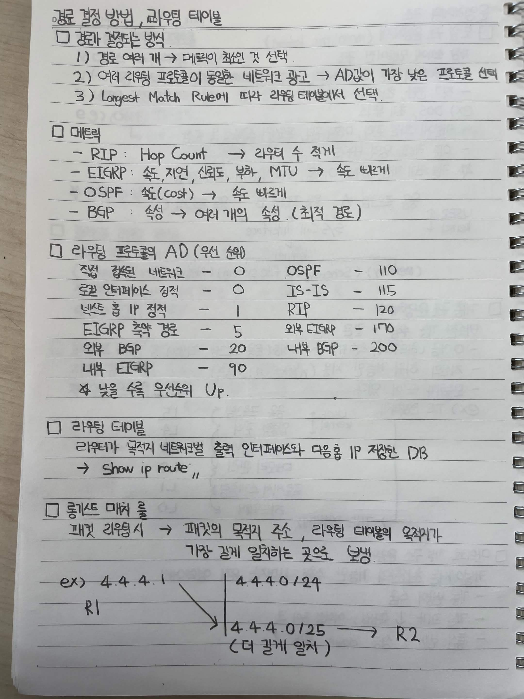

# 경로 결정 방법과 라우팅 테이블

경로 결정 방식

1. 경로가 여러 개라면 메트릭이 가장 낮은 경로를 선택한다.
2. 여러 라우팅 프로토콜이 동일한 네트워크 경로를 광고하면 AD 값이 가장 낮은 프로토콜을 선택한다.
3. Longest Match Rule에 따라 라우팅 테이블에서 목적지 주소와 가장 길게 일치하는 경로를 선택한다.

메트릭

RIP는 Hop Count를 사용하며 홉 수가 적을수록 우선순위가 높다.

EIGRP는 속도, 지연, 신뢰도, 부하, MTU 등을 고려하며 최적 경로를 계산한다.

OSPF는 Cost를 사용하며 비용이 낮을수록 우선순위가 높다.

BGP는 여러 속성을 기반으로 최적 경로를 선택한다.

라우팅 프로토콜의 AD 우선순위

직접 연결된 네트워크는 AD 0이다.

OSPF는 AD 110이다.

IS IS는 AD 115이다.

정적 경로는 AD 1이다.

RIP는 AD 120이다.

외부 EIGRP는 AD 170이다.

외부 BGP는 AD 20이다.

내부 BGP는 AD 200이다.

내부 EIGRP는 AD 90이다.

AD 값이 낮을수록 우선순위가 높다.

라우팅 테이블

라우터가 목적지 네트워크별 출력 인터페이스와 다음 홉 IP 주소를 저장한 데이터베이스이다.

라우팅 테이블을 확인하는 명령어는 다음과 같다.

`show ip route`

롱기스트 매치 룰

패킷을 라우팅할 때 목적지 주소와 라우팅 테이블의 네트워크 주소를 비교하여 가장 긴 프리픽스 길이로 일치하는 경로를 선택한다.

예시

목적지 IP 주소가 4.4.4.1이라고 가정한다.

라우팅 테이블에 4.4.4.0/24와 4.4.4.0/25가 있다면 두 경로 모두 목적지 주소와 일치한다.

이때 4.4.4.0/25가 더 긴 프리픽스 길이를 가지므로 해당 경로를 선택한다.

