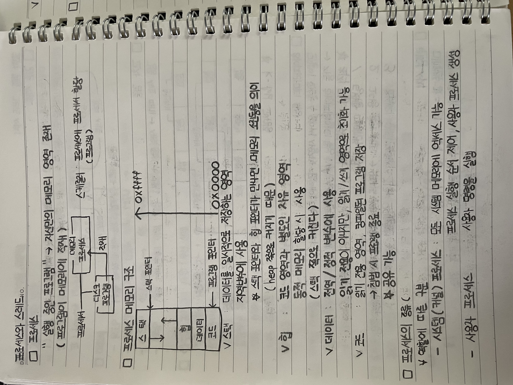
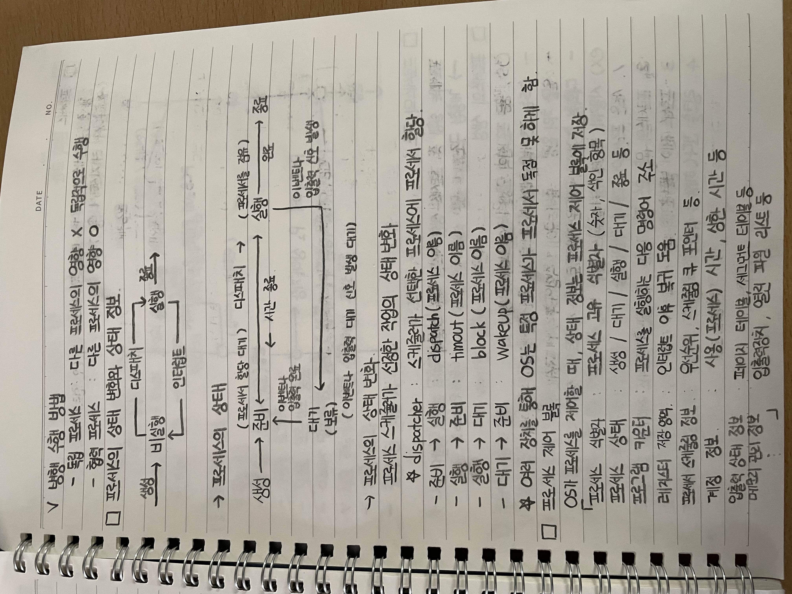
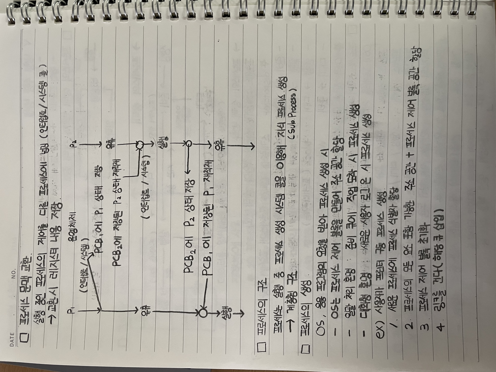
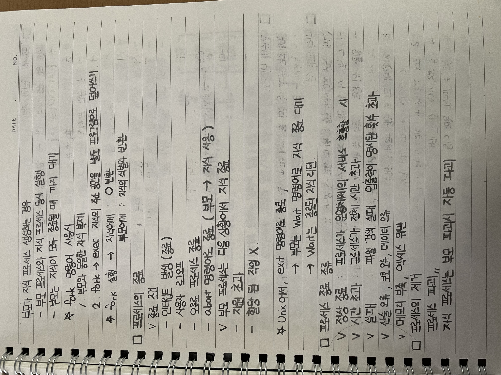
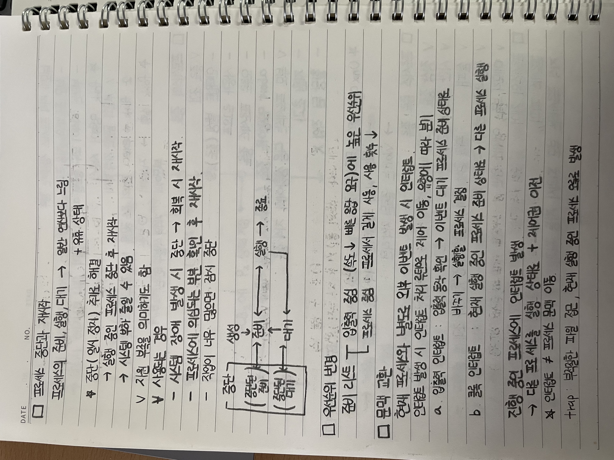
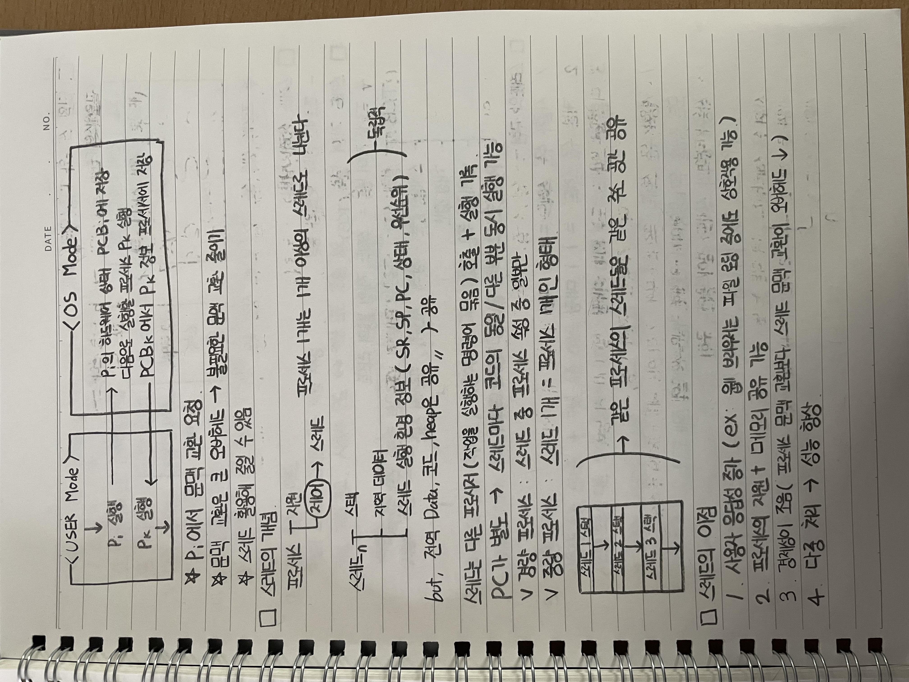
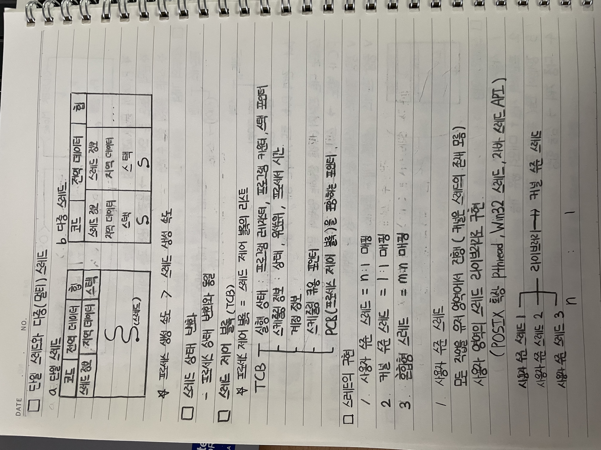
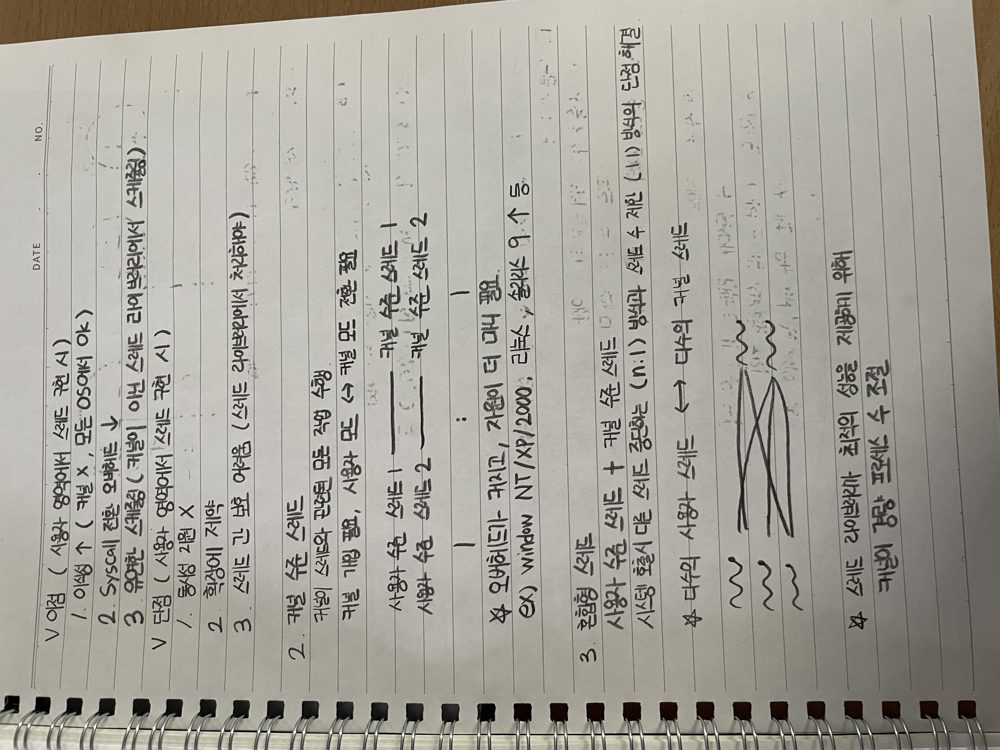
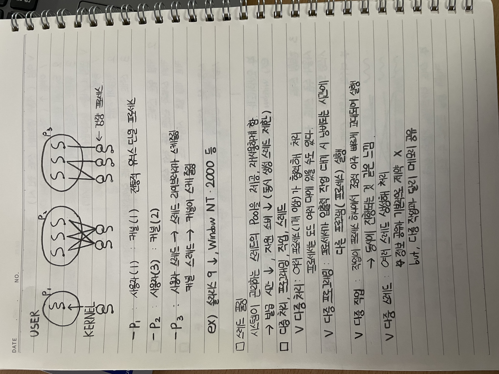

# 프로세스와 스레드

## 프로세스

- 실행 중인 프로그램
- 자신만의 메모리 영역 존재
- 프로그램이 메모리에 적재됨

- 스케줄러: 프로세스에 프로세서 할당

## 프로세스 메모리 구조

- 스택
  - 데이터를 일시적으로 저장하는 영역
  - 지역변수에 사용
  - 스택 포인터와 힙 포인터가 만나면 메모리 소진을 의미
  - 힙 쪽으로 커지기 때문에 스택과 충돌할 수 있음
- 힙
  - 코드 영역과 별도인 자유 영역
  - 동적 메모리 할당 시 사용
  - 스택 쪽으로 커짐
- 데이터
  - 전역 변수, 정적 변수에 사용
  - 읽기 전용이 아니지만 읽기 및 쓰기 영역으로 초기화 가능
- 코드
  - 읽기 전용 영역, 컴파일된 프로그램 저장
  - 침범 시 프로그램 종료
  - 공유 가능

## 프로세스의 종류

### 역할에 따른 구분

- 시스템(커널) 프로세스
  - 모든 시스템 메모리에 액세스 가능
  - 프로세서 실행 순서 제어, 사용자 프로세스 생성
- 사용자 프로세스
  - 사용자 명령을 실행

### 방향 수행 방법

- 독립 프로세스
  - 다른 프로세스의 영향 없음
  - 독립적으로 수행
- 협력 프로세스
  - 다른 프로세스의 영향 있음

## 프로세스의 상태 변화와 상태 정보

### 프로세스의 상태

- 생성
- 준비
- 실행
- 대기
- 종료

### 프로세스의 상태 변화

- 생성 -> 준비
- 준비 -> 실행: dispatch
- 실행 -> 준비: timeout
- 실행 -> 대기: block
- 대기 -> 준비: wakeup
- 실행 -> 종료: 완료

### 상태 변화 원인

- 이벤트나 입출력 완료
- 이벤트나 입출력 신호 발생
- 시간 종료

### 프로세스의 상태 변화

- 프로세스 스케줄러가 선정한 작업의 상태 변화
- dispatcher: 스케줄러가 선택한 프로세스에 프로세서 할당
- 준비 -> 실행: dispatch(프로세스 이름)
- 실행 -> 준비: timeout(프로세스 이름)
- 실행 -> 대기: block(프로세스 이름)
- 대기 -> 준비: wakeup(프로세스 이름)
- 여러 장치를 통해 OS는 특정 프로세서가 프로세서를 독점 못 하게 함

## 프로세스 제어 블록

OS가 프로세스를 제어할 때 상태 정보는 프로세스 제어 블록에 저장

- 프로세스 식별자: 프로세스 고유 식별자(숫자, 식별 항목)
- 프로세스 상태: 생성, 대기, 실행, 대기, 종료 등
- 프로그램 카운터: 프로세스를 실행하는 다음 명령어 주소
- 레지스터 저장 영역: 인터럽트 이후 복귀 도움
- 프로세서 스케줄링 정보: 우선순위, 스케줄링 큐 포인터 등
- 계정 정보: 사용(프로세스) 시간, 상한 시간 등
- 입출력 상태 정보: 페이지 테이블, 세그먼트 테이블 등
- 메모리 관리 정보: 입출력장치, 열린 파일 리스트 등

## 프로세스 문맥 교환

- 실행 중인 프로세스의 제어를 다른 프로세스에 넘김
- 인터럽트, 시스템 콜
- 교환 시 레지스터 내용 저장

### 문맥 교환 과정

1. P1의 상태를 PCB1에 저장
2. PCB2에 저장된 P2 상태 재적재
3. P2 실행
4. P2의 상태를 PCB2에 저장
5. PCB1에 저장된 P1 재적재
6. P1 실행

## 프로세스의 구조

- 프로세스는 실행 중 프로세스 생성 시스템 콜을 이용해 자식 프로세스 생성
- 계층형 구조
- Sub Process

## 프로세스의 생성

OS, 응용 프로그램의 요청을 받아 프로세스 생성 시

- OS는 프로세스 제어 블록을 만들어 주소 공간 할당
- 일괄 처리 환경: 준비 큐에 작업 도착 시 프로세스 생성
- 대화형 환경: 새로운 사용자 로그인 시 프로세스 생성

### 예시: 사용자가 프린터 구동 프로세스 생성

1. 새로운 프로세스에 프로세스 식별자 할당
2. 프로세스의 모든 요소 포함 가능한 주소 공간과 프로세스 제어 블록 공간 할당
3. 프로세스 제어 블록 초기화
4. 링크를 건다(해당 큐 삽입)

### 부모와 자식 프로세스 생성

- 부모 프로세스와 자식 프로세스 동시 실행
- 부모는 자식이 모두 종료될 때까지 대기

### fork 명령어 사용 시

1. 부모와 동일한 자식 복제
2. fork -> exec: 자식의 주소 공간을 별도 프로그램으로 덮어쓰기

### fork 실행 결과

- 자식에게: 0 반환
- 부모에게: 자식의 식별자 반환

## 프로세스의 종료

### 종료 조건

- 인터럽트 발생(종료)
- 사용자 요구
- 오류로 프로세스 종료
- abort 명령어로 종료(부모 -> 자식 사용)

### 부모 프로세스는 다음 상황에서 자식 종료

- 자원 초과
- 할당된 작업 없음

### Unix에서 프로세스 종료

- exit 명령어로 종료
- 부모는 wait 명령어로 자식 종료 대기
- wait는 종료된 자식 리턴

### 프로세스 종료 종류

- 정상 종료: 프로세스가 운영체제의 서비스 호출 시
- 시간 초과: 프로세스가 전체 시간 초과
- 실패: 파일 검색 실패, 입출력이 명시된 횟수 초과
- 산술 오류, 보호 오류, 데이터 오류
- 메모리 부족, 액세스 위반

## 프로세스의 제거

- 프로세스 파괴
- 자식 프로세스는 부모 파괴 시 자동 파괴

## 프로세스 중단과 재시작

- 프로세스의 준비, 실행, 대기 -> 일반 연산보다 느림
- 유휴 상태

### 중단(일시 정지) 치료 해결

- 실행 중인 프로세스 중단 후 재시작
- 시스템 부하 줄일 수 있음
- 자원 부족을 의미하기도 함

### 사용하는 경우

- 시스템 장애 발생 시 중단 -> 회복 시 재시작
- 프로세스에 의심되는 부분 확인 후 재시작
- 작업이 너무 많으면 잠시 중단

### 중단된 프로세스 상태

- 중단된 준비
- 중단된 대기

### 우선순위 변경

- 준비 리스트
  - 입출력 중심: 속도가 빠른 응답 요구에 높은 우선순위
  - 프로세스 중심: 프로세서 길게 사용, 사용 횟수 감소

## 문맥 교환

- 현재 프로세스와 별도로 외부 이벤트 발생 시 인터럽트
- 인터럽트 발생 시 인터럽트 처리 루틴으로 제어 이동
- 유형에 따라 분류

### 입출력 인터럽트

- 입출력 동작 확인
- 이벤트 대기 프로세스 준비 상태로 바꾸기
- 실행할 프로세스 변경

### 클록 인터럽트

- 현재 실행 중인 프로세스를 준비 상태로
- 다른 프로세스 실행

### 진행 중인 프로세스에 인터럽트 발생

- 다른 프로세스를 실행 상태로
- 제어권 이전

- 인터럽트 != 프로세스 문맥 이동
- trap: 부적절한 파일 접근, 현재 실행 중인 프로세스 오류 발생

### 문맥 교환 과정

- User Mode
  - P1 실행
  - P2 실행
- OS Mode
  - P1의 하드웨어 상태를 PCB1에 저장
  - 다음으로 실행할 프로세스 P2 실행
  - PCB2에서 P2 정보 프로세서에 저장

### 문맥 교환 특징

- P1에서 문맥 교환 요청
- 문맥 교환은 큰 오버헤드 -> 불필요한 문맥 교환 줄이기
- 스레드 활용해 줄일 수 있음

## 스레드의 개념

- 프로세스는 자원과 제어로 구분
- 프로세스 1개는 1개 이상의 스레드로 나뉨

### 스레드 구성

- 스택
- 지역 데이터
- 스레드 실행 환경 정보(SR, SP, PC, 상태, 우선순위)

### 공유와 독립

- 스택, 지역 데이터, 스레드 실행 환경 정보는 독립적
- 전역 Data, 코드, heap은 공유

### 스레드의 특징

- 스레드는 다른 프로세서(작업을 실행하는 명령어 묶음)의 호출과 실행 기록
- PC가 별도 -> 스레드마다 코드의 동일/다른 부분 동시 실행 가능

- 경량 프로세스: 스레드 중 프로세스 속성 중 일부만
- 중량 프로세스: 스레드 1개 = 프로세스 1개인 형태

## 스레드의 이점

1. 사용자 응답성 증가
   - 예: 웹 브라우저는 파일 로딩 중에도 상호작용 가능
2. 프로세스의 자원과 메모리 공유 가능
3. 경제성이 좋음
   - 프로세스 문맥 교환보다 스레드 문맥 교환의 오버헤드 감소
4. 다중 처리 -> 성능 향상

## 단일 스레드와 다중(멀티) 스레드

### 단일 스레드

- 코드, 전역 데이터, 힙
- 스레드 정보, 지역 데이터, 스택
- 스레드 1개

### 다중 스레드

- 코드, 전역 데이터, 힙 공유
- 각 스레드 정보, 지역 데이터, 스택은 별도

- 프로세스 생성 속도 > 스레드 생성 속도

## 스레드 상태 변화

- 프로세스 상태 변화와 동일

## 스레드 제어 블록(TCB)

- 프로세스 제어 블록 = 스레드 제어 블록의 리스트

### TCB 구성

- 실행 상태: 프로그램 레지스터, 프로그램 카운터, 스택 포인터
- 스케줄링 정보: 상태, 우선순위, 프로세서 시간
- 계정 정보
- 스케줄링 큐용 포인터
- PCB(프로세스 제어 블록)를 포함하는 포인터

## 스레드의 구현

1. 사용자 수준 스레드 = n:1 매핑
2. 커널 수준 스레드 = 1:1 매핑
3. 혼합형 스레드 = m:n 매핑

### 1. 사용자 수준 스레드

- 모든 작업을 사용자 영역에서 진행
- 커널은 스레드의 존재 모름
- 사용자 영역의 스레드 라이브러리로 구현
- POSIX 확장 pthread, Win32 스레드, 자바 스레드 API

#### 장점

1. 이식성 증가(커널 X, 모든 OS에서 OK)
2. Syscall 전환 오버헤드 감소
3. 유연한 스케줄링

#### 단점

1. 동시성 지원 X
2. 확장에 제약
3. 스레드 간 보호 어려움(스레드 라이브러리에서 처리해야)

### 2. 커널 수준 스레드

- 커널이 스레드와 관련된 모든 작업 수행
- 커널 개입 필요, 사용자 모드와 커널 모드 전환 필요
- 사용자 수준 스레드 1개와 커널 수준 스레드 1개가 매핑

- 오버헤드가 커지고, 자원이 더 많이 필요
- 예: Windows NT/XP/2000, 리눅스, 솔라리스 9.1 등

### 3. 혼합형 스레드

- 사용자 수준 스레드 + 커널 수준 스레드
- 시스템 호출 시 다른 스레드 중단하는 n:1 방식과 스레드 수 제한 1:1 방식의 단점 해결
- 다수의 사용자 스레드 <-> 다수의 커널 스레드
- 스레드 라이브러리가 최적의 성능을 제공하기 위해 커널이 경량 프로세스 수 조절

## 스레드 풀링

- 시스템이 관리하는 스레드의 Pool을 제공, 재사용하게 함
- 발급 시간 감소, 자원 소비 감소
- 동시 생성 스레드 제한

## 다중 처리, 프로그래밍, 작업, 스레드

### 다중 처리

- 여러 프로세서(기계 이상)가 협력해 처리
- 프로세서는 모든 여러 대에 있을 수도 있다.

### 다중 프로그래밍

- 프로세서가 입출력 작업 대기 시 낭비되는 시간에 다른 프로그램(프로세스) 실행

### 다중 작업

- 작업이 프로세스 하나에서 조정 아주 빠르게 교대되며 실행
- 동시에 진행되는 것 같은 느낌

### 다중 스레드

- 여러 스레드 생성해 처리
- 정보 공유 기본적으로 제약 X
- 다중 작업과 달리 메모리 공유

---

